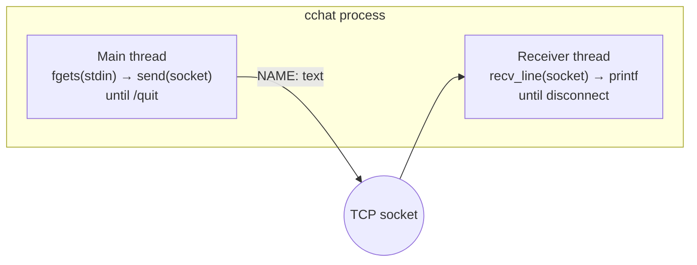

# cchat

A chat in plain C over TCP sockets. It works on a single machine (two terminals) or between machines on a network.

Rebuild of a Networks course assignment at FAAT.

## Structure

```
cchat/
├── include/
│   └── chat.h        # types and platform abstractions
├── src/
│   ├── main.c        # argument parsing and connection setup (server/client)
│   └── chat.c        # send/receive loop (threads)
└── Makefile
```

## Dependencies

| Platform | Compiler | Notes |
|------------|------------|------------|
| Windows    | GCC (MinGW) | `ws2_32` is linked automatically |
| Linux/macOS | GCC / Clang | `pthreads` is linked automatically |

## Building

```bash
# with Make (MinGW on Windows, or GCC on Linux/macOS)
make

# or straight with gcc on Windows
gcc -Wall -Iinclude -o cchat.exe src/main.c src/chat.c -lws2_32

# or on Linux/macOS
gcc -Wall -Iinclude -o cchat src/main.c src/chat.c -lpthread
```

## Usage

```
Server:  cchat server <port> <username>
Client:  cchat client <host> <port> <username>
```

### Same machine (two terminals)

```bash
# Terminal 1
./cchat server 5000 Alice

# Terminal 2
./cchat client localhost 5000 Bob
```

### Different machines on the network

```bash
# Machine A (IP: 192.168.1.10)
./cchat server 5000 Alice

# Machine B
./cchat client 192.168.1.10 5000 Bob
```

## Commands

| Command | Action |
|---------|------|
| `/quit` | Disconnect and exit |
| `Ctrl+C` | Force quit |

## How it works



- **Protocol.** Text messages terminated by `\n`, in the format `NAME: text\n`.
- **Threads.** One thread reads from the socket and prints. The main thread reads from stdin and sends.
- **Shutdown.** `/quit` calls `shutdown()`, which makes `recv()` on the other end return 0: a clean disconnect.

## Notes

- If the peer disconnects while you are typing, `[*] Connection closed by peer.` is shown. Press Enter to exit.
- Messages longer than 4095 bytes are truncated.
- One connection at a time (one to one).

## License

[MIT](LICENSE).
